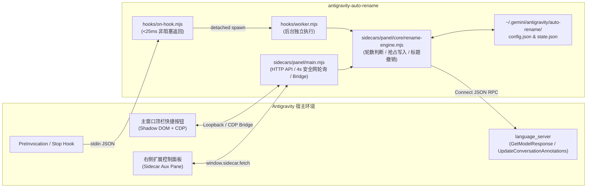

# Antigravity Auto Rename (`antigravity-auto-rename`)

<p align="center">
  <strong>Cross-platform Antigravity plugin for hook-based conversation title customization, periodic auto-renaming, and one-click manual renaming.</strong><br/>
  <strong>跨平台 Antigravity 插件：Hook 接管会话命名、自定义提示词（优先匹配发起语言）、每隔 N 次用户发言自动重命名，以及顶栏/侧边栏一键手动重命名。</strong>
</p>

<p align="center">
  <a href="#-简体中文">简体中文</a> •
  <a href="#-english">English</a> •
  <a href="./LICENSE">MIT License</a>
</p>

---

## <a id="-简体中文"></a> 简体中文

### 为什么需要这个插件？

Antigravity 客户端在用户发起新会话时，默认会由内置 `language_server` 使用一段**硬编码的英文提示词**生成 3~5 个英文单词的标题。即使你用中文提问，只要上下文中带有英文代码、报错日志或路径，会话列表也经常出现全英文标题，并且官方界面没有提供“自定义命名提示词”和“每隔几次对话自动刷新标题”的入口。

**`antigravity-auto-rename`** 基于 Antigravity 官方插件架构（`hooks.json` + `sidecars/` + 本地 Connect RPC）实现：

- **无需修改 `app.asar` 或二进制文件**，客户端升级不受影响；
- **无需配置外部第三方 API Key**，直接复用 Antigravity 内置轻量模型通道（`GetModelResponse`）与热更新接口（`UpdateConversationAnnotations`）；
- **全平台原生支持**：macOS / Windows / Linux。

---

### 核心功能

1. **Hook 接管首次会话命名（抢占原生英文生成器）**
   - 在用户发送第 1 条消息触发 `PreInvocation` 时，立即写入基于发起文本提取的初始标题抢占 `annotations.title`（使原生命名协程检测非空后自动跳过），随后通过内置模型按你的自定义提示词生成高质量标题并热更新会话列表。
2. **自定义命名提示词与发起语言锁定**
   - 默认规则：**「会话命名优先采用用户发起会话所采用的语言」**（例如首条提问为中文，即使后续对话充满英文代码、终端日志或技术缩写，仍严格使用简洁中文命名；首条为英文则生成英文标题）。
   - 支持自由编辑自定义附加提示词，并内置快捷开关：**保留关键英文缩写 / 添加 `[工作区目录名]` 前缀 / 添加语义 Emoji 前缀 / 限制最大字数**，还支持在面板中实时预览完整 Prompt。
3. **可配置每隔 $N$ 次用户发言自动重命名**
   - 例如配置每隔 `5` 次用户发言自动重命名（设为 `0` 则仅在首次提问时命名）。
   - 多轮重命名时会自动提取：**第 1 次用户发言（锁定语言与初衷） + 最近 $M$ 次用户发言（反映当前进展） + 最新助手回复摘要**，让长对话的标题随需求演进持续保持准确。
   - 支持配置触发时机：**用户发送消息时立即重命名 (`PreInvocation`)** 或 **本轮 AI 回复完成后重命名 (`Stop`)**。
4. **双入口手动重命名按钮 + 一键撤销**
   - **主窗口顶栏快捷按钮**：通过 CDP 无侵入挂载 `#ag-auto-rename-capsule`（**「✨ 重命名」** + **`▾` 快捷浮层**），点击即可对当前会话执行 AI 重命名，无需切换侧边栏；`▾` 菜单支持手动输入改名、↩ 恢复上一标题、快速修改周期 $N$ 和提示词。
   - **右侧扩展面板（Sidecar Aux Pane）**：完整配置中心、近期 20 个会话的状态总览（发起语言徽章、发言轮数、距离下次自动重命名倒计时）及逐条重命名按钮。

---

### 工作原理与架构



---

### 安装与部署

#### 前置要求
- **Node.js** `>= 18.0.0`
- **Antigravity** 客户端

#### 1. 克隆仓库并链接到 Antigravity 插件目录

**macOS / Linux：**
```bash
git clone https://github.com/ankeliei/antigravity-auto-rename.git ~/workspace/antigravity-auto-rename
mkdir -p ~/.gemini/config/plugins
ln -sfn ~/workspace/antigravity-auto-rename ~/.gemini/config/plugins/auto-rename
```

**Windows (PowerShell，需管理员权限或开启开发者模式)：**
```powershell
git clone https://github.com/ankeliei/antigravity-auto-rename.git "$HOME\workspace\antigravity-auto-rename"
New-Item -ItemType Directory -Force -Path "$env:USERPROFILE\.gemini\config\plugins" | Out-Null
New-Item -ItemType SymbolicLink -Path "$env:USERPROFILE\.gemini\config\plugins\auto-rename" -Target "$HOME\workspace\antigravity-auto-rename"
```

> 也可以在 `~/.gemini/config/plugins/` 下直接克隆本仓库，省去创建软链接的步骤。

#### 2. 重载 Antigravity
重启或重载一次 Antigravity 窗口，宿主会自动发现并启用 `auto-rename` 插件：
- 在主窗口顶部标题栏右侧可看到 **「✨ 重命名 | ▾」** 胶囊按钮；
- 在插件/扩展菜单中可打开 **「会话自动重命名」** 完整设置面板。

---

### 配置项说明

所有配置均可在 UI 中可视修改，并持久化保存在 `~/.gemini/antigravity/auto-rename/config.json`（可通过环境变量 `AUTO_RENAME_DATA_DIR` 覆盖）：

| 配置字段 | 默认值 | 说明 |
| :--- | :--- | :--- |
| `enabled` | `true` | 是否启用插件自动重命名接管 |
| `hookFirstTurn` | `true` | 是否拦截并接管第 1 次发言的会话命名 |
| `autoRenameInterval` | `5` | 每隔多少次用户发言自动重命名（`0` 表示仅首次命名） |
| `contextRecentTurns` | `5` | 多轮重命名时额外参考最近 $M$ 条用户发言（始终保留第 1 条） |
| `includeAssistantSummary` | `true` | 多轮重命名时是否附带最新助手回复摘要 |
| `triggerTiming` | `"pre"` | 触发时机：`"pre"`（发出消息时立即）或 `"stop"`（AI 回复结束后） |
| `enableWindowOverlay` | `true` | 是否通过 CDP 在主窗口顶栏挂载快捷重命名按钮 |
| `preferInitiationLanguage` | `true` | 是否强制优先采用第 1 条用户消息的自然语言 |
| `keepTechTerms` | `true` | 是否保留关键技术缩写与文件名（如 `RPC`、`SQLite`） |
| `addWorkspacePrefix` | `false` | 是否在标题前添加 `[工作区目录名]` 前缀 |
| `addEmojiPrefix` | `false` | 是否在标题前添加语义 Emoji |
| `maxTitleCharsZh` | `14` | 中文标题建议字数上限 |
| `maxTitleWordsEn` | `6` | 英文标题建议词数上限 |
| `modelEnum` | `1050` | 内置命名模型枚举（默认 `1050`，失败时自动回退至可用轻量模型） |
| `customPromptRules` | （内置中文优先规则） | 自定义附加提示词 |

---

### 开发与测试

```bash
npm test
```

<br/>

---

## <a id="-english"></a> English

### Why This Plugin?

When a new conversation starts in Antigravity, the built-in `language_server` runs a **hardcoded English prompt** inside `maybeGenerateConversationTitle` asking for a 3–5 word title-cased English title. Even if you start a conversation in Chinese, Japanese, or another language—especially when code snippets, logs, or file paths are present—conversations frequently end up with English titles, and there is no built-in way to customize the naming prompt or periodically re-title evolving multi-turn sessions.

**`antigravity-auto-rename`** solves this cleanly using Antigravity's native customization primitives (`hooks.json` + `sidecars/` + local Connect JSON RPC):

- **Zero `app.asar` patching**: Never modifies Antigravity's application bundle or binaries; survives client updates intact.
- **Zero external API keys**: Uses Antigravity's built-in utility model RPC (`GetModelResponse`) and pushes live UI updates via `UpdateConversationAnnotations`.
- **Cross-platform**: Works on **macOS**, **Windows**, and **Linux**.

---

### Key Features

1. **Hook & Preempt First-Turn Conversation Naming**
   - On the first user message (`PreInvocation`), immediately claims `annotations.title` with a quick sanitized fallback title (causing Antigravity's native title generator to abort when it detects `ann.Title` is non-empty), then generates the final title with your custom prompt via `GetModelResponse` and updates the sidebar reactively.
2. **Custom Naming Prompts & Initiation-Language Lock**
   - Automatically detects the natural language of the opening user message (ignoring code blocks, URLs, and file paths) and locks future titles to that language by default.
   - Customizable prompt instructions plus toggle presets for keeping technical acronyms intact, adding a `[workspace]` prefix, adding a semantic emoji prefix, and configurable title length bounds—with live prompt preview in the panel.
3. **Auto-Rename Every $N$ User Turns**
   - Configurable turn interval $N$ (default `5`; set to `0` for first-turn-only naming).
   - Multi-turn renames pass **Turn #1** (preserving the original goal and initiation language) together with the **most recent $M$ user turns** (default `5`) and an optional latest assistant snippet so the title stays aligned as the conversation evolves.
   - Configurable trigger timing: **`PreInvocation`** (immediately when you send a message) or **`Stop`** (after the assistant completes its turn).
4. **Dual Manual Rename Controls + One-Click Undo**
   - **Main Window Titlebar Capsule (`✨ 重命名 | ▾`)**: Non-invasively mounted into the titlebar via `DevToolsActivePort` (CDP) inside isolated Shadow DOM roots with `-webkit-app-region: no-drag`. One click triggers AI rename for the active `/c/<uuid>` conversation; the `▾` dropdown opens a compact popover for manual title editing, undo, interval $N$ adjustment, and prompt tweaks.
   - **Sidecar Auxiliary Pane**: Full settings UI, prompt preview, active conversation controls, and a recent-conversations list with per-item rename actions.

---

### Project Layout

```text
antigravity-auto-rename/
├── plugin.json                         # Native plugin manifest
├── .antigravity-plugin/plugin.json     # Archive-compatible manifest
├── hooks.json                          # PreInvocation & Stop lifecycle hooks
├── hooks/
│   ├── on-hook.mjs                     # Fast non-blocking hook entrypoint (<25ms)
│   └── worker.mjs                      # Detached background worker
├── sidecars/panel/
│   ├── sidecar.json                    # Auxiliary pane sidecar manifest
│   ├── main.mjs                        # Sidecar HTTP server + 4s fallback watcher + bridge
│   ├── core/
│   │   ├── config.mjs                  # Cross-platform settings & state persistence
│   │   ├── ls-client.mjs               # Cross-platform language_server discovery & Connect RPC
│   │   ├── prompt-builder.mjs          # Language detection, transcript parsing & prompt builder
│   │   ├── rename-engine.mjs           # Preemption, turn-interval scheduling & undo logic
│   │   └── window-bridge.mjs           # Non-invasive CDP titlebar overlay controller
│   └── web/                            # Sidecar web UI & main-window Shadow DOM overlay
└── test/
    └── rename-engine.test.mjs          # Node built-in test suite
```

---

### Installation

#### Prerequisites
- **Node.js** `>= 18.0.0`
- **Antigravity** desktop application

#### 1. Clone and Link to `~/.gemini/config/plugins`

**macOS / Linux:**
```bash
git clone https://github.com/ankeliei/antigravity-auto-rename.git ~/workspace/antigravity-auto-rename
mkdir -p ~/.gemini/config/plugins
ln -sfn ~/workspace/antigravity-auto-rename ~/.gemini/config/plugins/auto-rename
```

**Windows (PowerShell with Developer Mode or Administrator):**
```powershell
git clone https://github.com/ankeliei/antigravity-auto-rename.git "$HOME\workspace\antigravity-auto-rename"
New-Item -ItemType Directory -Force -Path "$env:USERPROFILE\.gemini\config\plugins" | Out-Null
New-Item -ItemType SymbolicLink -Path "$env:USERPROFILE\.gemini\config\plugins\auto-rename" -Target "$HOME\workspace\antigravity-auto-rename"
```

#### 2. Reload Antigravity
Restart or reload the Antigravity window. The `auto-rename` plugin is enabled automatically:
- Look for the **「✨ 重命名 | ▾」** button in the main window titlebar;
- Open **会话自动重命名** from the extensions/sidecar menu for full settings and recent conversation management.

---

### Configuration Reference

Settings are stored at `~/.gemini/antigravity/auto-rename/config.json` (override with `AUTO_RENAME_DATA_DIR`):

| Key | Default | Description |
| :--- | :--- | :--- |
| `enabled` | `true` | Master toggle for automatic naming hooks |
| `hookFirstTurn` | `true` | Intercept and override native turn-1 naming |
| `autoRenameInterval` | `5` | Re-run AI naming every $N$ user turns (`0` = turn 1 only) |
| `contextRecentTurns` | `5` | Number of recent user turns included alongside turn 1 |
| `includeAssistantSummary` | `true` | Include a brief snippet of the latest assistant reply |
| `triggerTiming` | `"pre"` | `"pre"` (on user submit) or `"stop"` (after assistant reply) |
| `enableWindowOverlay` | `true` | Mount the titlebar quick-rename capsule via CDP |
| `preferInitiationLanguage` | `true` | Lock generated title language to turn-1 user language |
| `keepTechTerms` | `true` | Preserve technical acronyms, filenames, and library names |
| `addWorkspacePrefix` | `false` | Prepend `[workspace-folder]` to generated titles |
| `addEmojiPrefix` | `false` | Prepend a topic-relevant emoji |
| `maxTitleCharsZh` | `14` | Target max character length for Chinese titles |
| `maxTitleWordsEn` | `6` | Target max word count for English titles |
| `modelEnum` | `1050` | Built-in utility model enum (auto-falls back if unavailable) |
| `customPromptRules` | *(Chinese-first rule)* | Custom prompt instructions appended to the generator prompt |

---

### Development & Testing

```bash
npm test
```

---

### License

[MIT](./LICENSE) © 2026 [ankeliei](https://github.com/ankeliei)
